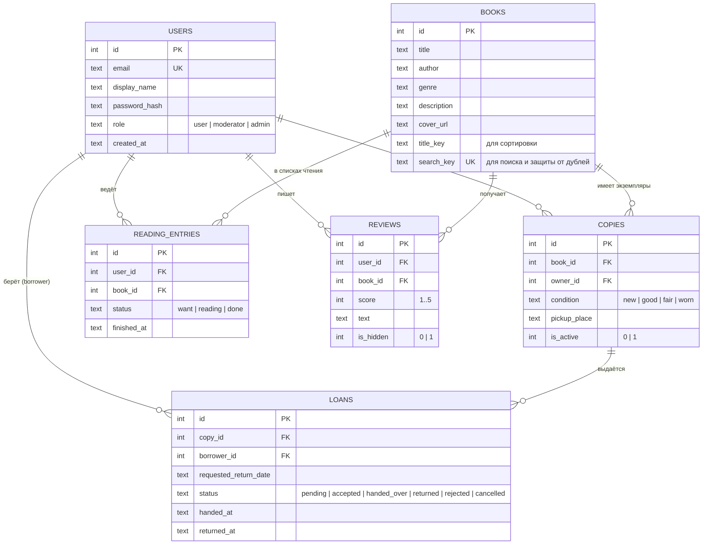

# ER-диаграмма BookCircle

Диаграмму можно открыть на GitHub/GitLab (отображается автоматически) или вставить код в https://mermaid.live.

## Что изменено относительно предложенной модели и почему

| Изменение | Обоснование |
|---|---|
| `User`: добавлены `email`, `display_name`, `password_hash`, `role`, `created_at` | В задании сказано «У всех сущностей есть PK», но для входа и ролей нужны учётные данные и роль. Роль одна на пользователя, проверка CHECK-ограничением. |
| `Book`: добавлены `title_key`, `search_key`, `created_at` | SQLite сравнивает регистр только для латиницы, поэтому для регистронезависимого поиска по кириллице название/автор хранятся в нижнем регистре (`casefold`). `UNIQUE(search_key)` не даёт завести дубли книг. |
| `Loan`: добавлен `created_at` | Для истории и сортировки обменов. |
| `Review`: добавлены `created_at`, `updated_at` | Рецензию можно редактировать — нужно знать, когда она изменена, и сортировать по свежести. |
| Просрочка **не хранится** | Вычисляется: `status = 'handed_over'` и `requested_return_date < сегодня`. Хранимое поле устаревало бы само по себе. |
| Доступность экземпляра **не хранится** | Вычисляется: `is_active = 1` и нет займа в статусах `accepted`/`handed_over`. Единственный источник правды — таблица `loans`. |
| Все внешние ключи `ON DELETE RESTRICT` | Исторические записи (обмены, отзывы) не удаляются каскадно. Экземпляр с историей обменов нельзя удалить — только скрыть (`is_active = 0`). |

## Ограничения и индексы на уровне БД

| Правило | Как обеспечено |
|---|---|
| Не более одной принятой/активной передачи на экземпляр (атомарно) | `UNIQUE INDEX ux_loans_one_active_per_copy ON loans(copy_id) WHERE status IN ('accepted','handed_over')` + транзакция `BEGIN IMMEDIATE` в сервисе |
| Нет двух ожидающих запросов одного человека на один экземпляр | `UNIQUE INDEX ux_loans_one_pending_per_borrower ON loans(copy_id, borrower_id) WHERE status='pending'` |
| Владелец не одалживает книгу себе | Триггер `trg_loans_no_self_loan` + проверка в сервисе (понятное сообщение) |
| Одна запись чтения на пару пользователь/книга | `UNIQUE(user_id, book_id)` в `reading_entries` |
| Одна рецензия на пару пользователь/книга | `UNIQUE(user_id, book_id)` в `reviews`; редактирование — `INSERT … ON CONFLICT DO UPDATE` |
| Оценка 1–5, допустимые статусы/роли/состояния | `CHECK` |
| `finished_at` только у «Прочитал» | `CHECK (status = 'done' OR finished_at IS NULL)` |

Индексы: по всем внешним ключам (`copies.book_id/owner_id`, `loans.copy_id/borrower_id`,
`reading_entries.user_id/book_id`, `reviews.book_id`), по фильтрам и сортировке каталога
(`books.genre`, `books.title_key`), по статусам (`loans(copy_id,status)`, `loans(borrower_id,status)`,
`reading_entries(book_id,status,finished_at)` для статистики месяца, `reviews(book_id,is_hidden)` для рейтинга).
